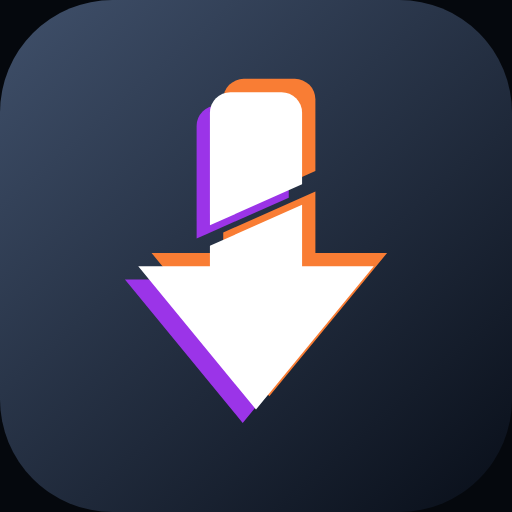
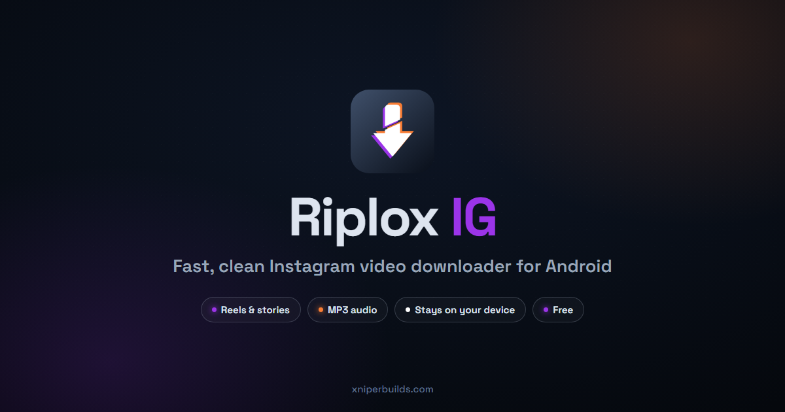
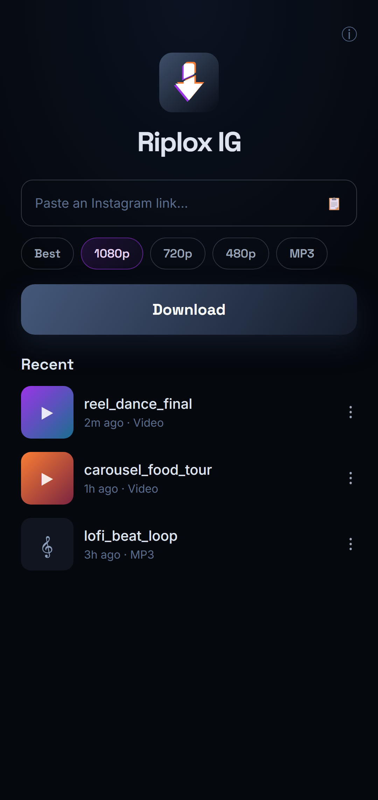
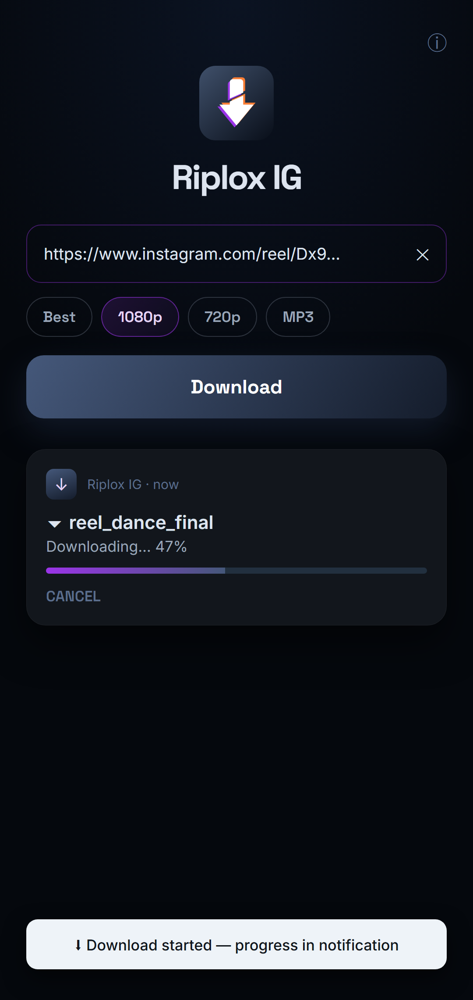
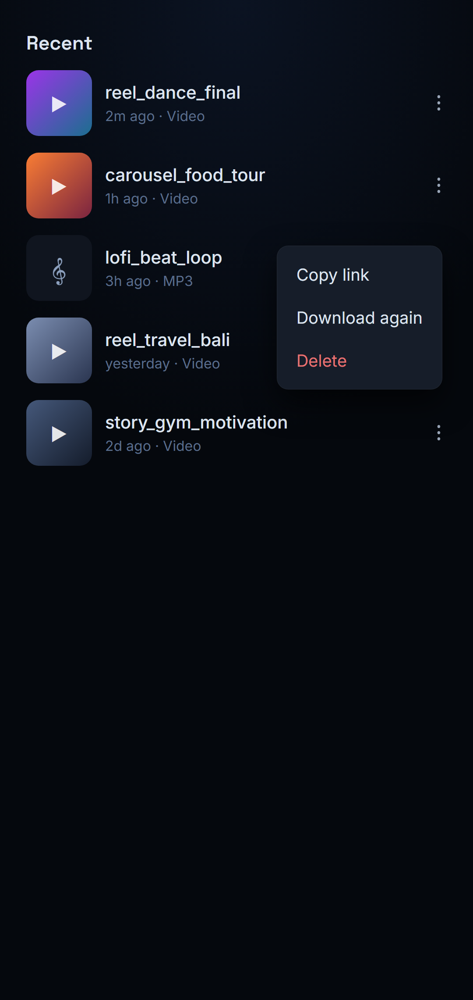
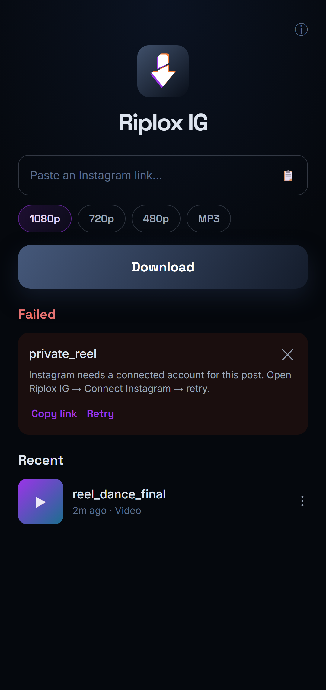

<div align="center">



# Riplox IG

**Fast, clean Instagram downloader for Android.**

Paste a link or share from the Instagram app — reels, video posts, stories and carousels land straight in your gallery.

[](https://github.com/xniperbuilds/riplox-ig/releases/latest)
[](https://github.com/xniperbuilds/riplox-ig/releases)
[](LICENSE)




</div>

---

## Screenshots

| Home | Downloading | Recent | Failed → retry |
|:---:|:---:|:---:|:---:|
|  |  |  |  |

## Features

- ⬇️ **Reels, video posts & IGTV** — paste an Instagram link, or share one straight from the app
- 🖼️ **Photos too** — single photo posts and the picture slides in a carousel, straight to `Pictures/RiploxIG`
- 🎠 **Carousels** — a multi-item post downloads every item it contains, video and photo, in one go
- 🚪 **Two ways in** — Riplox IG asks Instagram directly first and falls back to the yt-dlp engine, so one of them going down does not take the app with it
- 📖 **Stories** — from an account you can already see
- 🎚️ **Pick your quality** — Best / 1080p / 720p / 480p, or extract **MP3** audio. Your choice is remembered
- 🔑 **Connect Instagram (optional)** — sign in once for private posts and stories. You sign in on Instagram's own page; the app never sees your password
- ⚡ **Share from Instagram** — the download starts on its own, and a small sheet shows the thumbnail, live progress and a Cancel button. Dismiss it and the download keeps going in the background
- 🔧 **Update & retry** — when a share fails you get the real reason plus a one-tap engine refresh, without opening the app
- 🔔 **Live notification** — real progress, cancel anytime; downloads survive app-close & reboot with auto-retry
- ♻️ **Failed? One tap** — every failure gives you **Copy link** and **Retry**, right where you are
- 🕘 **Recent list** — tap to play, copy link, download again, or delete
- 📁 **Straight to your gallery** — video in `Movies/RiploxIG`, audio in `Music/RiploxIG`
- 🎨 **Clean AMOLED-black UI** — Material 3, one calm screen, no clutter

- 🔥 **Daily check-in streak** — tap **Check in** each day and accent colours unlock at 3, 7, 14 and 30 days; a 7-day streak pays a **whole ad-free day**
- 🎁 **Two hours with no ads** — watch one short ad and the app goes quiet, banner and full screen both. Watch again to add more, up to a day. Nothing that was free has moved behind it

## What does *not* work yet

Being straight about it, so nobody downloads this expecting the wrong thing:

- **Posts your account cannot already see.** Riplox IG can only reach what you can reach. A private account you do not follow, or an age-restricted post your account is not cleared for, will refuse — and it says so plainly instead of showing a raw error.
- **Whole profiles in one go.** One post, reel or story at a time, on purpose.

> **Photo posts now work** (since v1.1.0) — single photos and the picture slides in a mixed carousel save to `Pictures/RiploxIG`.

## Install

1. Download the latest APK from [**Releases**](https://github.com/xniperbuilds/riplox-ig/releases/latest)
2. Open it — allow *"Install from unknown sources"* if Android asks
3. Open Riplox IG, paste an Instagram link, tap **Download**

> Android 8.0 (Oreo) or newer. Works on both 64-bit and 32-bit phones.

## How it works

Riplox IG is a native Jetpack Compose app built on the [yt-dlp](https://github.com/yt-dlp/yt-dlp) + FFmpeg engine. It does **one thing well**: pull an Instagram video (or its audio) down cleanly, with a background queue that doesn't give up when your connection hiccups.

Two things are worth knowing about the design:

- **The engine keeps itself current.** Instagram changes its API often, and extractor fixes land in yt-dlp's nightly channel first — so that is the channel the app follows. If a link fails on a fresh install because the bundled engine is stale, the app updates it and retries automatically instead of showing you a failure.
- **A login is optional and reversible.** Instagram blocks a lot of content for signed-out visitors, so Connect Instagram exists — but if the session goes bad (Instagram sometimes answers a logged-in request with an empty body), the app automatically retries the same link as a guest, and a switch lets you turn the login off without logging out.

## FAQ

**Do I need to log in?**
Not for public reels and posts. Connect Instagram is for private posts and stories, and for the times Instagram refuses a signed-out request. You sign in on Instagram's own page inside the app — the app never sees or stores your password, and the session stays on your phone.

**Where is my login stored?**
In the app's private storage on the device, and it is excluded from cloud backup and device transfer. Nothing is uploaded anywhere. "Re-login" refreshes it; the switch disables it without logging out.

**A link won't download?**
Instagram rate-limits requests from time to time. Tap **Retry** in a minute. If it keeps failing on private content, use **Connect Instagram** with an account that can actually see that post. Deleted or region-locked posts can't be downloaded.

**Where do my files go?**
Your gallery — `Movies/RiploxIG` for video, `Music/RiploxIG` for MP3, `Pictures/RiploxIG` for any images that do come through.

**Is it safe?**
It's open source — read the code. No analytics and no tracking of what you download. Being upfront: the released build **does include the AdMob SDK** (a banner, plus an interstitial after every second completed download).

**Only Instagram?**
Yes, by design. For TikTok see [Riplox TT](https://github.com/xniperbuilds/riplox-tt); for 1000+ other sites see [Riplox](https://github.com/xniperbuilds/riplox).

## Building from source

```bash
git clone https://github.com/xniperbuilds/riplox-ig.git
cd riplox-ig
./gradlew assembleDebug
```

Android Studio (JDK 17+) recommended. Release builds are signed with the maintainer's key; your local builds fall back to a debug signature automatically.

## Credits

- [yt-dlp](https://github.com/yt-dlp/yt-dlp) · [youtubedl-android](https://github.com/yausername/youtubedl-android) · [FFmpeg](https://ffmpeg.org/)
- [Coil](https://coil-kt.github.io/coil/) · Jetpack Compose / Material 3

## License

[GPL-3.0](LICENSE) — free forever. If you distribute a modified version, it must stay open source.

## Disclaimer

Riplox IG is an independent app and is **not affiliated with, endorsed by, or connected to Instagram or Meta Platforms, Inc.** "Instagram" is a trademark of its respective owner and is used here only to describe compatibility. Please download only content you have the right to save, and respect creators' rights.

---

<div align="center">

**Riplox IG** is a [XniperBuilds](https://xniperbuilds.com) product.

⭐ Star the repo if Riplox IG saves you time — it helps more people find it.

</div>
